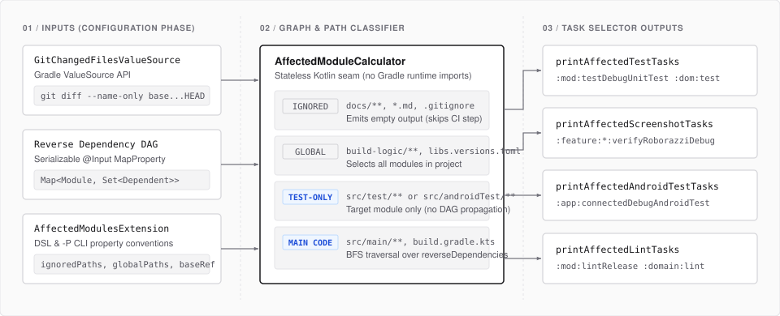
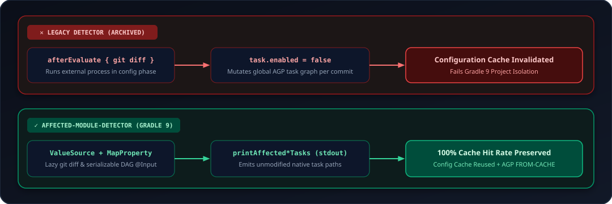
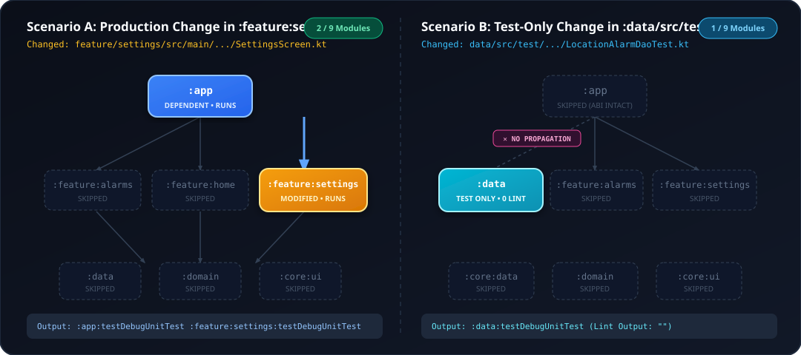

# Affected Module Detector — Gradle 9 Plugin

[](https://gradle.org)
[](https://kotlinlang.org)
[](#why-this-plugin-exists)
[](#why-this-plugin-exists)

A lightweight, zero-dependency Gradle 9+ plugin that computes the exact subset of module **unit test**, **Roborazzi screenshot**, **instrumented `androidTest`**, and **Android/JVM Lint** tasks affected by a Git change set—including transitive dependents across the project dependency graph—without breaking the **Gradle Configuration Cache** or **Gradle Build Cache**.

<p align="center">
  
</p>

---

## Why This Plugin Exists

Legacy plugins such as Dropbox's `AffectedModuleDetector` (archived in 2023) relied on running `git diff` during Gradle's evaluation phase and dynamically mutating `task.enabled = false` across subprojects. In modern Gradle (8.x and 9.x) and Android Gradle Plugin (AGP 9+):

1. **Mutating `task.enabled` per commit invalidates the Configuration Cache** on every branch/commit change.
2. **Accessing `Task.project` at execution time violates Gradle 9 project isolation rules.**
3. **Altering task graphs interferes with standard AGP Build Cache (`FROM-CACHE`) fingerprinting.**

`com.danielriverolosa.affected-modules` solves this by acting as a **decoupled task selector**:
- It extracts the multi-module reverse dependency DAG into serializable `@Input` maps during configuration.
- It reads `git diff` lazily via Gradle's Configuration-Cache-safe `ValueSource` API (`GitChangedFilesValueSource`).
- It outputs the exact list of unmodified native Gradle tasks (`:module:testDebugUnitTest`, `:module:verifyRoborazziDebug`, `:module:connectedDebugAndroidTest`, `:module:lintRelease`) so CI invokes standard tasks with 100% intact Build Cache and Configuration Cache semantics.

<p align="center">
  
</p>

---

## How Graph Propagation Works

<p align="center">
  
</p>

### Change Classification Matrix

| Change Type | Example Path | Propagation Behavior | Tasks Emitted |
| :--- | :--- | :--- | :--- |
| **Ignored Paths** | `docs/ARCHITECTURE.md`, `README.md`, `.gitignore` | Ignored | None (`""` — CI skips execution) |
| **Global Build Paths** | `build-logic/**`, `gradle/libs.versions.toml`, `build.gradle.kts`, `settings.gradle.kts` | All modules in repository | Unit Test, Screenshot, `androidTest` & Lint tasks for **all** applicable modules |
| **Unit Test-Only Changes** | `feature/checkout/src/test/**` | **No propagation** (production ABI unchanged) | Unit & Screenshot tasks for the modified module only; **0** `androidTest` or Lint tasks |
| **Instrumented Test-Only Changes** | `app/src/androidTest/**` | **No propagation** (production ABI unchanged) | `androidTest` task for the modified module only; **0** unit test, screenshot, or Lint tasks |
| **Production Changes** | `domain/src/main/**`, `domain/build.gradle.kts` | **Transitive BFS** up the reverse dependency DAG | Unit Test, Screenshot, `androidTest` & Lint tasks for the module + all direct and transitive dependents |

---

## Installation (GitHub Packages)

### 1. Configure `settings.gradle.kts`

Add the GitHub Packages Maven repository inside `pluginManagement`:

```kotlin
pluginManagement {
    repositories {
        google()
        mavenCentral()
        gradlePluginPortal()
        maven {
            name = "GitHubPackages"
            url = uri("https://maven.pkg.github.com/danielriverolosa/affected-module-detector")
            credentials {
                username = providers.gradleProperty("gpr.user").filter { it.isNotBlank() }
                    .orElse(providers.environmentVariable("GITHUB_ACTOR").filter { it.isNotBlank() })
                    .orNull
                password = providers.gradleProperty("gpr.key").filter { it.isNotBlank() }
                    .orElse(providers.environmentVariable("PACKAGES_TOKEN").filter { it.isNotBlank() })
                    .orElse(providers.environmentVariable("GITHUB_TOKEN").filter { it.isNotBlank() })
                    .orNull
            }
        }
    }
}
```

> [!IMPORTANT]
> **Authentication Requirements:**
> GitHub Packages Maven requires a token with `read:packages` scope for downloading artifacts:
> - **Local development:** Set `gpr.user=<github-username>` and `gpr.key=<token-with-read:packages>` in `~/.gradle/gradle.properties`.
> - **GitHub Actions CI:** Provide `PACKAGES_TOKEN` (a token with `read:packages`) in repository secrets.

### 2. Register in `gradle/libs.versions.toml`

```toml
[versions]
affectedModules = "0.2.0"

[plugins]
affected-modules = { id = "com.danielriverolosa.affected-modules", version.ref = "affectedModules" }
```

### 3. Apply in Root `build.gradle.kts`

```kotlin
plugins {
    alias(libs.plugins.affected.modules)
}

affectedModules {
    baseRef.set("origin/master")
}
```

---

## DSL Configuration Reference

| Property | Type | Default | Description |
| :--- | :--- | :--- | :--- |
| `baseRef` | `Property<String>` | `"origin/master"` | Git reference used as the base for `git diff --name-only <baseRef>...HEAD`. Overridable via `-PbaseRef=<ref>`. |
| `ignoredPaths` | `ListProperty<String>` | `["docs/", ".md", ".gitignore", ".github/"]` | Directory prefixes (ending with `/`), file extensions (starting with `.`), or exact paths that do not trigger any module tasks. |
| `globalPaths` | `ListProperty<String>` | `["build-logic/", "gradle/libs.versions.toml", "gradle/wrapper/", "build.gradle.kts", "settings.gradle.kts", "gradle.properties"]` | Root files or directory prefixes whose modification marks all project modules as affected. |
| `androidUnitTestTaskName` | `Property<String>` | `"testDebugUnitTest"` | Unit test task name emitted for modules with `com.android.application`, `com.android.library`, or `com.android.test`. |
| `jvmTestTaskName` | `Property<String>` | `"test"` | Unit test task name emitted for pure JVM modules (`org.jetbrains.kotlin.jvm`, `java-library`). |
| `androidInstrumentationTestTaskName` | `Property<String>` | `"connectedDebugAndroidTest"` | Instrumented `androidTest` task name emitted for Android modules containing `src/androidTest` (overridable via `-PandroidTestTaskName=...`). |
| `screenshotTestTaskName` | `Property<String>` | `"verifyRoborazziDebug"` | Screenshot task name emitted for modules applying `screenshotPluginId` (overridable via `-PscreenshotTaskName=recordRoborazziDebug`). |
| `screenshotPluginId` | `Property<String>` | `"io.github.takahirom.roborazzi"` | Gradle plugin ID used to identify modules with screenshot tests. |
| `lintTaskName` | `Property<String>` | `"lintRelease"` | Lint task name emitted for Android modules (and `"lint"` fallback for JVM modules with `com.android.lint`). |

---

## CLI Tasks & Properties

### Tasks

| Task | Output | Description |
| :--- | :--- | :--- |
| `./gradlew -q printAffectedTestTasks` | Space-separated task list | Prints unit test tasks (`testDebugUnitTest` / `test`) for affected modules and transitive dependents. |
| `./gradlew -q printAffectedAndroidTestTasks` | Space-separated task list | Prints instrumented `androidTest` tasks (`connectedDebugAndroidTest` or GMD task) for affected Android modules with `src/androidTest`. |
| `./gradlew -q printAffectedScreenshotTasks` | Space-separated task list | Prints Roborazzi screenshot tasks (`verifyRoborazziDebug` / `recordRoborazziDebug`) for affected modules applying Roborazzi. |
| `./gradlew -q printAffectedLintTasks` | Space-separated task list | Prints lint tasks (`lintRelease` / `lint`) for affected modules and transitive dependents. |

### CLI Property Overrides

- `-PbaseRef=<git-ref>`: Overrides `affectedModules.baseRef` (e.g., `-PbaseRef=origin/main`).
- `-PandroidTestTaskName=<task>`: Overrides the instrumented test task name (e.g., `-PandroidTestTaskName=pixel6Api34DebugAndroidTest`).
- `-PscreenshotTaskName=<task>`: Overrides the screenshot task name (e.g., `-PscreenshotTaskName=recordRoborazziDebug`).
- `-PchangedFiles=<csv>`: Bypasses `git diff` and computes affected tasks for an explicit comma-separated list of relative paths:
  ```bash
  ./gradlew -q printAffectedScreenshotTasks -PchangedFiles="feature/checkout/src/main/kotlin/CheckoutScreen.kt" -PscreenshotTaskName=recordRoborazziDebug
  # Output: :feature:checkout:recordRoborazziDebug
  ```

---

## GitHub Actions CI Integration

Ensure `actions/checkout` fetches git history (`fetch-depth: 0`) so `origin/master` is resolvable by `git diff`:

```yaml
- name: Checkout
  uses: actions/checkout@v7
  with:
    fetch-depth: 0

- name: Run Affected Unit & Roborazzi Tests
  env:
    GITHUB_ACTOR: ${{ github.actor }}
    PACKAGES_TOKEN: ${{ secrets.PACKAGES_TOKEN }}
  run: |
    AFFECTED_TASKS=$(./gradlew -q printAffectedTestTasks -PbaseRef=origin/master)
    if [ -z "$AFFECTED_TASKS" ]; then
      echo "No modules affected for unit tests. Skipping."
    else
      echo "Running affected test tasks: $AFFECTED_TASKS"
      ./gradlew $AFFECTED_TASKS -Proborazzi.test.verify=true
    fi
```

---

## Local Development & Verification

```bash
# Run unit tests, Gradle TestKit configuration-cache tests, and strict plugin validation
./gradlew check

# Publish to local Maven repository (~/.m2/repository) for local integration testing
./gradlew publishToMavenLocal
```

See [`docs/ARCHITECTURE.md`](docs/ARCHITECTURE.md) for internal design details.
