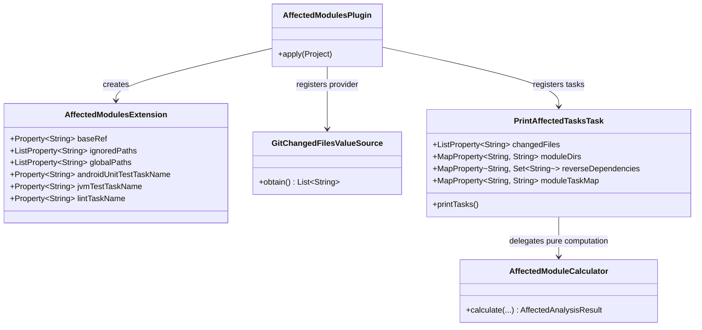
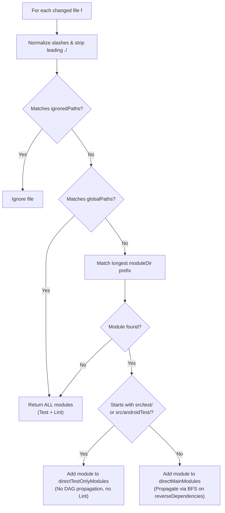

# Architecture & Internal Design

This document describes the internal architecture of `affected-module-detector` (`com.danielriverolosa.affected-modules`) and explains how it achieves compatibility with **Gradle 9**, **Configuration Cache**, and **Build Cache**.

---

## 1. Design Principles & Seam Separation

The plugin is structured around a deep, framework-agnostic core (`AffectedModuleCalculator`) surrounded by a thin Gradle 9 adapter layer:

### Component Responsibilities

1. **[`AffectedModuleCalculator`](../src/main/kotlin/com/danielriverolosa/gradle/affected/AffectedModuleCalculator.kt)**:
   - Pure Kotlin object with zero `org.gradle.*` imports.
   - Accepts plain collections (`List<String>`, `Map<String, String>`, `Map<String, Set<String>>`) and returns `AffectedAnalysisResult`.
   - Tested directly via fast JVM unit tests in [`AffectedModuleCalculatorTest`](../src/test/kotlin/com/danielriverolosa/gradle/affected/AffectedModuleCalculatorTest.kt).

2. **[`GitChangedFilesValueSource`](../src/main/kotlin/com/danielriverolosa/gradle/affected/GitChangedFilesValueSource.kt)**:
   - Implements Gradle's `ValueSource<List<String>, Parameters>`.
   - Executes `git diff --name-only <baseRef>...HEAD` (falling back to `git diff --name-only <baseRef>`) via injected `ExecOperations`.

3. **[`PrintAffectedTasksTask`](../src/main/kotlin/com/danielriverolosa/gradle/affected/PrintAffectedTasksTask.kt)**:
   - Annotated with `@DisableCachingByDefault` because its sole output is a single line printed to `stdout`.
   - Declares only primitive/collection `@Input` properties (`ListProperty`, `MapProperty`, `Property`). Never references `Project` at execution time.

4. **[`AffectedModulesPlugin`](../src/main/kotlin/com/danielriverolosa/gradle/affected/AffectedModulesPlugin.kt)**:
   - Inspects subprojects once in `gradle.projectsEvaluated`, extracting module directories, production `ProjectDependency` edges (`!config.name.lowercase().contains("test")`), and module plugin types (`com.android.*` vs `org.jetbrains.kotlin.jvm` / `java-library`).
   - Registers `printAffectedTestTasks` and `printAffectedLintTasks` on the root project.

---

## 2. Cache-Safety Architecture

### Why Legacy Detectors Break Gradle 9

| Anti-Pattern in Legacy Plugins | Consequence in Gradle 9 | How `affected-module-detector` Avoids It |
| :--- | :--- | :--- |
| Running `ProcessBuilder("git", "diff")` inside `afterEvaluate {}` | External process execution during configuration invalidates Configuration Cache on every commit | Uses `ValueSource` (`GitChangedFilesValueSource`) wired lazily to task `@Input` |
| Setting `subproject.tasks.configureEach { enabled = false }` | Mutates the global task graph based on git state; breaks Configuration Cache and prevents running explicit tasks | Never mutates any existing task; outputs task paths so CI invokes standard tasks directly |
| Referencing `project.subprojects` inside `@TaskAction` | Fails Gradle 9 Configuration Cache serialization (`Task.project` access forbidden) | Pre-computes `Map<String, String>` and `Map<String, Set<String>>` into serializable `MapProperty` task inputs |

---

## 3. Reverse Dependency Graph & File Classification

### Longest-Prefix Module Resolution
In nested multi-module hierarchies (e.g., `:core` at `core/` and `:core:domain` at `core/domain/`), `AffectedModuleCalculator` sorts candidate modules by directory path length descending before matching. A file at `core/domain/src/main/UseCase.kt` deterministically resolves to `:core:domain` rather than `:core`.

### Production vs Test Dependency Edges
When building `reverseDependencies`, `AffectedModulesPlugin` ignores test-only configurations (`testImplementation`, `androidTestImplementation`). If `:moduleA` only depends on `:moduleB` in `testImplementation`, a change in `:moduleB` will trigger `:moduleB` tests, and only production dependents propagate transitively.
